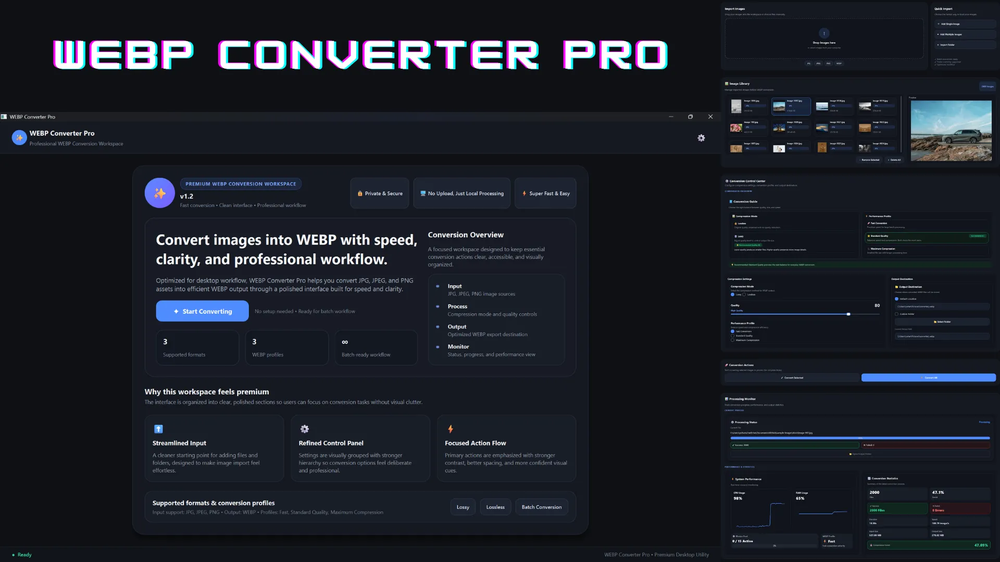
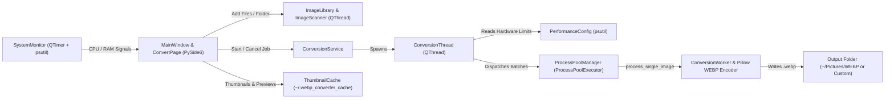
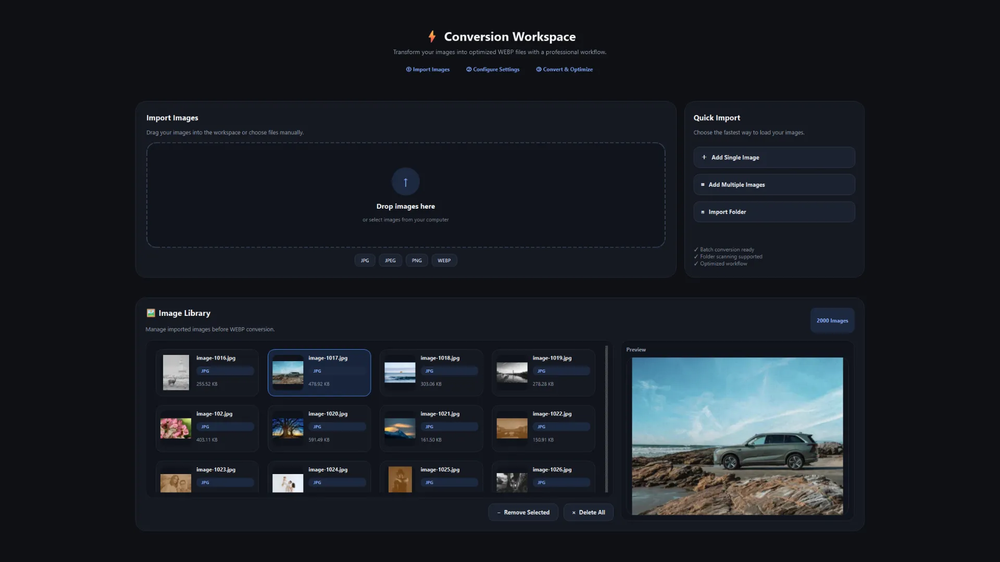
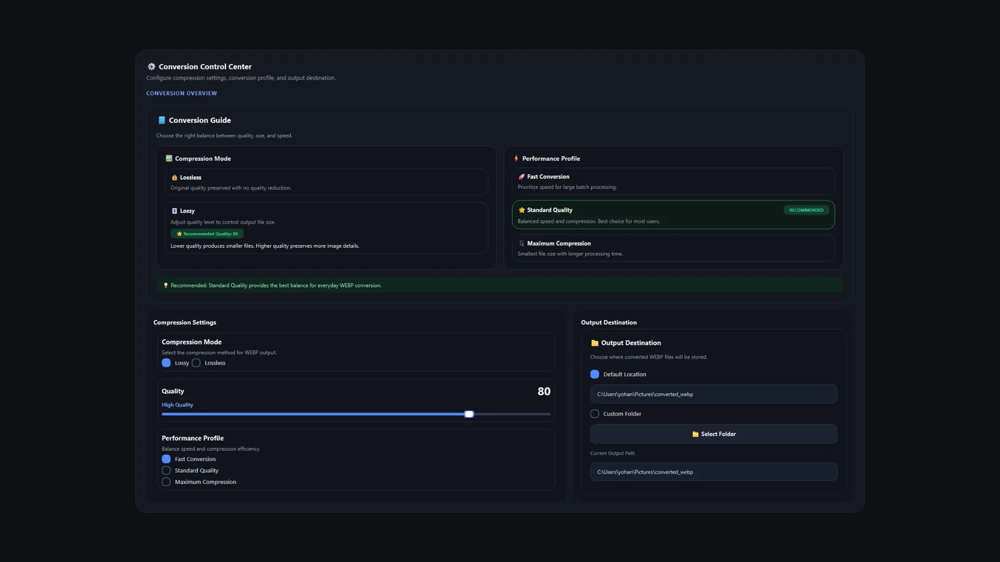
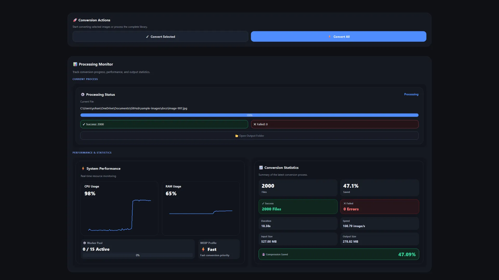

# WEBP Convertor Pro




## Project Overview

WEBP Convertor Pro is a local-first Windows desktop utility engineered for high-throughput batch conversion of JPG, JPEG, and PNG images into optimized WEBP files. It addresses the slowdown and privacy trade-offs of browser-based converters by running multi-process encoding directly on the user's machine. Designed for web developers, designers, and content teams handling large asset libraries, the application combines a dark-themed PySide6 interface with hardware-aware worker scaling and real-time CPU, memory, and compression telemetry.

## Key Features

- **Flexible Image Import**: Add single files, select multiple images, drag and drop files directly into the drop zone, or recursively scan entire directories in the background via `ImageScanner`.
- **Interactive Image Library & Preview**: Browse loaded images in a thumbnail grid with cached WebP previews, file metadata display, single-item removal with automatic next-item selection, and full library clearing.
- **Lossy & Lossless Compression Controls**: Switch between Lossy and Lossless WEBP encoding modes with an adjustable quality slider (1–100, default 80) and automatic RGBA transparency preservation.
- **Three Performance Profiles**: Choose between `Fast Conversion` (method 2), `Standard Quality` (method 4), and `Maximum Compression` (method 6) to balance throughput against file-size reduction.
- **Hardware-Adaptive Multiprocessing**: Automatically detects logical CPU threads using `PerformanceConfig` and dispatches encoding tasks across a `ProcessPoolExecutor` worker pool (`max(2, min(cpu_threads - 1, 32))`).
- **Batch Execution & Cancellation**: Convert either the currently selected image or the entire loaded library, with safe in-flight job cancellation and one-click access to the output folder.
- **Live Telemetry & Compression Analytics**: Monitor real-time CPU and RAM utilization charts via `PyQtGraph`, active worker pool occupancy, throughput (`image/s`), elapsed duration, and percentage space saved.

## Supported Platforms

| Platform | Operating System | Minimum Version | Support / Test Status |
| :--- | :--- | :--- | :--- |
| Windows Desktop | Windows (x64) | Windows 10+ | Configured, packaged (`dist/WEBP Converter Pro.exe`), and verified |
| Linux / macOS | Python 3 Desktop | Python 3.10+ | Framework-compatible via source (`PySide6`), not packaged or tested |

## Tech Stack

| Category | Technology | Purpose |
| :--- | :--- | :--- |
| Programming Language | Python | Core application logic, multiprocessing orchestration, and UI bindings |
| Desktop UI Framework | PySide6 | Qt6 windows, stacked navigation, signals/slots, and background `QThread` workers |
| Image Processing | Pillow | Decoding JPG/JPEG/PNG sources, color-mode normalization, and WEBP encoding |
| Real-Time Charting | PyQtGraph | Live 60-point rolling CPU and RAM usage plots in `ResourceChart` |
| System Telemetry | psutil | Hardware core/thread detection and periodic CPU/RAM sampling via `SystemMonitor` |
| UI Styling | qt-material / QSS | Dark workspace theming and custom widget stylesheets in `app/styles/theme.py` |
| Packaging | PyInstaller | One-file windowed Windows executable bundling via `WEBP-Converter.spec` |

## Application Architecture

The application follows a decoupled desktop architecture separating presentation widgets, Qt service coordinators, and CPU-bound multiprocessing workers. `MainWindow` hosts a `QStackedWidget` switching between `HomePage` and `ConvertPage`. Inside `ConvertPage`, `ImageLibrary` manages scanned assets while `ConversionService` launches a `ConversionThread` (`QThread`) that delegates image batches to `ProcessPoolManager` (`ProcessPoolExecutor`), keeping the Qt main thread responsive as progress, worker count, and `SystemMonitor` telemetry signals update the UI.



## Screenshots / Preview

### 1. Conversion Workspace & Image Library

The primary import and asset-management view features a drag-and-drop zone alongside quick-import buttons for single images, multi-file selection, and recursive folder scanning. Below it, the Image Library panel renders cached thumbnails with format badges, selection controls (`Remove Selected` and `Delete All`), and a live side preview pane.

### 2. Conversion Control Center & Output Destination

This configuration view pairs a Conversion Guide comparing Lossless, Lossy, and Performance Profiles with interactive controls for Compression Mode, Quality slider (1–100), and encoding profile selection. On the right, users can keep the default output location or browse for a custom destination folder.

### 3. Conversion Actions & Processing Monitor

The execution and analytics dashboard provides `Convert Selected` and `Convert All` triggers above a live Processing Status card showing the active file, progress bar, and success/error counters. Beneath it, System Performance displays rolling CPU/RAM PyQtGraph charts and active worker-pool utilization alongside final Conversion Statistics (files processed, duration, speed in `image/s`, input/output megabytes, and total compression savings).

## Prerequisites

- **End Users (Windows Executable)**:
  - Windows 10 or Windows 11 (64-bit).
  - No Python runtime required when running the packaged `WEBP Converter Pro.exe`.
- **Developers (Running or Building from Source)**:
  - Python 3.10+ (verified on Python 3.15 in `.venv`).
  - `pip` package manager.
  - Visual C++ / Windows desktop environment for PySide6 GUI rendering (or `QT_QPA_PLATFORM=offscreen` for headless widget tests).

## Installation & Setup

1. Clone the repository and navigate to the project directory:
   ```bash
   git clone https://github.com/weztcy/WEBP-Convertor-Pro.git
   cd "WEBP Convertor Pro"
   ```
2. Create and activate a Python virtual environment:
   ```powershell
   python -m venv .venv
   .venv\Scripts\Activate.ps1
   ```
3. Install the required dependencies from `requirements.txt`:
   ```powershell
   pip install -r requirements.txt
   ```
4. Launch the application from source:
   ```powershell
   python main.py
   ```

## Application Configuration

No manual environment files or external configuration setup are required; defaults are managed directly in `app/core/` and can be adjusted in the UI at runtime.

| Configuration | Description | Default / Example |
| :--- | :--- | :--- |
| Default Output Directory | Destination created by `get_default_output()` in `app/core/config.py` | `~/Pictures/WEBP` |
| Thumbnail & Preview Cache | Local WebP cache directory initialized by `ThumbnailCache` | `~/.webp_converter_cache/{thumbnails,previews}` |
| Compression Mode | WEBP encoding mode in `app/core/converter.py` (`lossy` or `lossless`) | `lossy` (UI default) |
| Quality Level | Lossy WEBP quality factor (`1` to `100`) in `SettingsPanel` | `80` |
| WEBP Encoding Profile | Speed-vs-compression profile in `app/core/webp_profile.py` | `fast` (`method=2`; also `balanced=4`, `compression=6`) |
| Worker Pool Limit | Parallel worker count computed by `PerformanceConfig.calculate_workers()` | `max(2, min(cpu_threads - 1, 32))` |
| Resource Monitor Interval | Polling interval for `SystemMonitor` CPU/RAM sampling (`QTimer`) | `1000` ms |

## Database & Local Storage

The application operates offline without a relational database and relies on deterministic local disk caching for fast UI responsiveness during large batch imports.

| Storage Mechanism | Purpose | Location & Details |
| :--- | :--- | :--- |
| Thumbnail Disk Cache | Stores 100px WebP thumbnails keyed by MD5 of path, mtime, and size | `~/.webp_converter_cache/thumbnails/<md5>.webp` |
| Preview Disk Cache | Stores 400px WebP previews (`quality=85`) for the inspector pane | `~/.webp_converter_cache/previews/<md5>.webp` |
| In-Memory Pixmap Cache | Avoids redundant disk reads when switching between selected items | `ThumbnailCache.memory_cache` dictionary (`QPixmap`) |

## Testing

The repository includes standalone verification scripts covering UI library deletion/preview concurrency, hardware detection, process pool execution, and system monitoring.

- `test_delete_fix.py`: Headless PySide6 (`QT_QPA_PLATFORM=offscreen`) assertions validating `ImageList`, `ImageSection`, sequential deletion auto-selection, and stale `ImagePreview` loader protection.
- `test_hardware.py`, `test_monitor.py`, `test_pool.py`, `test_chart.py`, and `test_performance.py`: Component diagnostic scripts for `PerformanceConfig`, `SystemMonitor`, `ProcessPoolManager`, `ResourceChart`, and batch throughput benchmarking.

Run the UI regression suite in headless mode with:

```powershell
python test_delete_fix.py
```

## Build & Packaging

The project includes `WEBP-Converter.spec` and `version_info.txt` to compile the application into a standalone, windowed Windows executable with `assets/app_icon.ico` and UPX compression enabled.

1. Ensure `pyinstaller` is installed in the active virtual environment (included in `requirements.txt`).
2. Run PyInstaller against the spec file:
   ```powershell
   pyinstaller --noconfirm --clean WEBP-Converter.spec
   ```
3. Locate the generated single-file executable at `dist/WEBP Converter Pro.exe` (approx. 67.93 MB).

## Device Features & Permissions

The application uses standard local desktop operating-system capabilities without requiring elevated administrator privileges or network permissions.

| Feature / Permission | Purpose | Platform |
| :--- | :--- | :--- |
| Local Filesystem Read/Write | Scans source folders for JPG/JPEG/PNG images, writes WEBP outputs, and caches thumbnails | Windows |
| Hardware CPU & Memory Telemetry | Queries logical core counts and live CPU/RAM usage via `psutil` and `os.cpu_count()` | Windows |
| Desktop Shell Integration | Opens the user's selected output directory directly from the Processing Monitor | Windows |

## Usage

After launching the application via `python main.py` or `dist/WEBP Converter Pro.exe`:

1. Click **Start Converting** on the home screen to open the Conversion Workspace.
2. Drag and drop `.jpg`, `.jpeg`, or `.png` files into the **Import Images** drop area, or use **Quick Import** (`Add Single Image`, `Add Multiple Images`, or `Import Folder`).
3. Inspect thumbnails and previews in the **Image Library**, removing any unwanted files with **Remove Selected** or **Delete All**.
4. In the **Conversion Control Center**, select **Lossy** or **Lossless** mode, adjust the **Quality** slider if using Lossy mode, choose a **Performance Profile**, and confirm the **Output Destination**.
5. Click **Convert Selected** or **Convert All** to start multiprocessing conversion and monitor live CPU/RAM charts, worker activity, and compression savings in the **Processing Monitor**.

## Contributing

Contributions are welcome to improve encoding workflows, UI responsiveness, or platform packaging.

1. Fork the repository.
2. Create a branch for the change.
3. Make the changes.
4. Validate or test the changes when applicable.
5. Commit and push the branch.
6. Open a pull request with a clear explanation.

## License

This project is licensed under the MIT License.
See the [LICENSE](LICENSE) file for details.

## Author & Contact

**Yohanes Dimas Pratama**

- GitHub: [github.com/weztcy](https://github.com/weztcy)
- Portfolio: [yohanesdimas.com](https://yohanesdimas.com)
- LinkedIn: [linkedin.com/in/yohanes-dimas](https://www.linkedin.com/in/yohanes-dimas)
